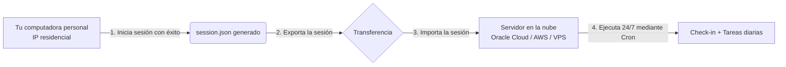

# Guía avanzada: ejecución en servidores en la nube y gestión de sesiones

> 🌐 **Idiomas:** [Português](CLOUD_SESSIONS.md) | [English](CLOUD_SESSIONS.en.md) | [Español](CLOUD_SESSIONS.es.md)

> ℹ️ Traducción al español de la documentación canónica en portugués. En caso de divergencia, prevalece la versión en portugués.

Esta guía explica en detalle el funcionamiento de los mecanismos de seguridad de AliExpress en entornos de nube (Oracle Cloud, AWS, Google Cloud, DigitalOcean, Hetzner, etc.) y el método recomendado de **delegación de sesión** (generación local y exportación al servidor).

> [!TIP]
> **Login manual asistido (2.0.0):** en una computadora con interfaz gráfica, ejecuta
> `node collect.js` (o `./run_all.sh`) y elige la **opción 2** cuando aparezca el menú.
> El bot abre una ventana de AliExpress para que resuelvas login/captcha/2FA, guarda la
> sesión automáticamente y reanuda en headless. En VPS/cron sin GUI el menú no aparece;
> en ese caso usa el flujo de exportación/importación descrito a continuación.

---

## Índice

1. [El desafío de las IP de datacenter (anti-bot Baxia)](#1-el-desafío-de-las-ip-de-datacenter-anti-bot-baxia)
2. [¿Por qué la autenticación funciona en el PC y falla en la nube?](#2-por-qué-la-autenticación-funciona-en-el-pc-y-falla-en-la-nube)
3. [La solución: delegación de sesión (generar local -> exportar a la nube)](#3-la-solución-delegación-de-sesión-generar-local---exportar-a-la-nube)
4. [Métodos para transferir la sesión](#4-métodos-para-transferir-la-sesión)
   - [Método 1: utilidades automáticas (`export_session.js` e `import_session.js`)](#método-1-utilidades-automáticas-export_sessionjs-e-import_sessionjs)
   - [Método 2: transferencia directa mediante SCP](#método-2-transferencia-directa-mediante-scp)
   - [Método 3: creación directa mediante terminal (here-doc)](#método-3-creación-directa-mediante-terminal-here-doc)
5. [Duración y renovación de la sesión](#5-duración-y-renovación-de-la-sesión)
6. [Cambio de cuentas en la nube](#6-cambio-de-cuentas-en-la-nube)
7. [Optimizaciones para VPS con poca memoria (512 MB - 1 GB RAM)](#7-optimizaciones-para-vps-con-poca-memoria-512-mb---1-gb-ram)
8. [Programación en Cron con notificaciones de Telegram](#8-programación-en-cron-con-notificaciones-de-telegram)
9. [Rotación periódica de secretos y pruning de backups](#9-rotación-periódica-de-secretos-y-pruning-de-backups)
10. [Monitorear si el cron murió (Dead Man's Switch / Heartbeat)](#10-monitorear-si-el-cron-murió-dead-mans-switch--heartbeat)
11. [Higiene y rotación de logs del cron (logrotate)](#11-higiene-y-rotación-de-logs-del-cron-logrotate)

---

## 1. El desafío de las IP de datacenter (anti-bot Baxia)

AliExpress (Grupo Alibaba) emplea un sistema corporativo de control de riesgo y protección anti-automatización llamado **Baxia**. Este sistema evalúa la puntuación de reputación de cada conexión:

- **Rangos de IP de datacenter:** servidores en la nube como Oracle Cloud, AWS EC2, DigitalOcean o Linode tienen bloques ASN públicos catalogados como datacenters/hosting.
- **Detección de nuevo login:** cuando se envía un formulario de login (usuario y contraseña) desde una IP de nube en modo headless (sin interfaz gráfica), Baxia interrumpe el flujo exigiendo:
  1. **Slide Captcha de alta resolución:** un control deslizante con verificación de telemetría de ratón, aceleración y entropía humana.
  2. **Verificación en dos pasos (2FA):** envío de un código de 6 dígitos al email o SMS registrado en la cuenta.

Si estos desafíos no se resuelven, AliExpress no emite la cookie maestra de autenticación (`xman_us_t`). Como consecuencia:

- El check-in no identifica la cuenta (`0 monedas`, racha `N/D`).
- El panel de tareas ("Gana más monedas") no carga ni abre la gaveta.

> [!IMPORTANT]
> **Detección automática de fallo de login:**
> Si el script no logra obtener simultáneamente la racha de días, las monedas del check-in diario y el saldo total de la cuenta, alerta explícitamente `[ERRO AO EFETUAR O LOGIN]`, purga la sesión inválida e interrumpe la rutina de inmediato para evitar ejecuciones con datos a cero o bloqueos en el panel de tareas.

---

## 2. ¿Por qué la autenticación funciona en el PC y falla en la nube?

1. **IP residenciales:** tu conexión de internet residencial (proveedores comunes de banda ancha) tiene alta reputación. AliExpress rara vez desafía el envío de credenciales desde computadoras personales.
2. **Reutilización de cookies:** AliExpress **no bloquea** el acceso a la central de monedas por IP de datacenter si la solicitud ya contiene una sesión previamente autenticada (cookies `xman_us_t`, `aep_usuc_f`, etc.).
3. **Conclusión:** basta con hacer login una sola vez en tu computadora personal y transferir los archivos de sesión generados a tu servidor en la nube.

---

## 3. La solución: delegación de sesión (generar local -> exportar a la nube)

El flujo de trabajo ideal para mantener la automatización funcionando 24/7 en la nube es:



1. **En la computadora personal:** ejecuta el script normalmente (`./run_all.sh` en Linux/macOS o `run_all.bat` en Windows). La sesión se autenticará y guardará en `session.json`.
2. **Transferencia:** envía los archivos de sesión a la carpeta `ali-coins` de tu servidor en la nube.
3. **En el servidor en la nube:** ejecuta `./run_all.sh`. El script detectará la sesión válida, hará el handshake de cookies y se ejecutará a diario sin pedir nunca la contraseña ni disparar captchas.

---

## 4. Métodos para transferir la sesión

### Método 1: utilidades automáticas (`export_session.js` e `import_session.js`)

El proyecto incluye scripts dedicados para la exportación e importación de sesión cifrada con **AES-256-GCM** (usando `scrypt` para la derivación de clave y la etiqueta de autenticación):

#### A. Exportación en la computadora personal (donde se realizó el login)

Define la variable `SESSION_SECRET` (mínimo 32 caracteres) en `credentials.env` o en el entorno:

- **Exportar todas las cuentas activas (predeterminado en entorno multicuenta):**

  ```bash
  node export_session.js
  # o explícitamente:
  node export_session.js --all
  ```

  El script exportará todas las cuentas configuradas generando tokens individuales:
  - Cuenta 1 -> `session_token.txt`
  - Cuenta 2 -> `session_token_2.txt`
  - Cuenta N -> `session_token_N.txt`

- **Exportar solo una cuenta específica:**
  ```bash
  # Por índice numérico (1, 2, ...):
  node export_session.js --account=2

  # O por el email de la cuenta:
  node export_session.js --account="usuario@gmail.com"
  ```

Los tokens cifrados (formato `v3:N:r:p:salt:iv:tag:ciphertext` o heredados `v2`/`v1`) se guardan con permisos restringidos `0o600`. Por seguridad contra filtraciones en pantallas y logs, la terminal muestra solo el fingerprint SHA-256 y el tamaño del archivo. (Si necesitas mostrar el token completo en pantalla, añade `--show-token`).

#### B. Importación en el servidor en la nube (dentro de `~/ali-coins`)

Transfiere los archivos de token generados a la carpeta del proyecto en el servidor:

- **Importar TODAS las cuentas de una sola vez:**

  ```bash
  node import_session.js --all
  ```

  La utilidad procesa todos los archivos `session_token*.txt` del directorio, los descifra con tu `SESSION_SECRET`, reconoce cada cuenta por `meta.user` y guarda en los archivos aislados correspondientes (`session.json.enc`, `session_<hash>.json.enc`, etc.), aplicando `0o600` a todos.

  > 🧹 **Higiene de tokens:** por defecto, cada `session_token*.txt` se **elimina de forma segura tras la importación correcta** (el token es de un solo uso). Si necesitas conservarlos (ej.: replicar la importación en otro host), usa `node import_session.js --all --keep-tokens` o define `KEEP_SESSION_TOKENS=true`.

- **Importar individualmente (mediante STDIN - recomendado):**

  ```bash
  # Cuenta 1:
  node import_session.js < session_token.txt

  # Cuenta 2:
  node import_session.js < session_token_2.txt
  ```

- **Importar individualmente (mediante archivo o flag explícita):**
  ```bash
  node import_session.js --from-file=session_token_2.txt
  # o especificando la cuenta:
  node import_session.js --account=2 < session_token_2.txt
  ```

> 🔒 **Enrutamiento automático inteligente y protección multicuenta:**
> Aunque no especifiques `--account`, el importador analiza el email incrustado en el token cifrado y lo compara con las cuentas registradas en el `credentials.env` del servidor remoto. Si el token pertenece a la Cuenta 2, lo guardará automáticamente en `session_<hash>.json.enc`, **sin sobrescribir ni corromper nunca la sesión de la Cuenta 1**.
>
> 🔒 **Seguridad del shell:** el script rechaza tokens directamente en `process.argv` para impedir la filtración de credenciales en el historial del shell (`~/.bash_history`) o en el listado de procesos del sistema (`ps aux`). La memoria del búfer del token se borra justo después del descifrado.

---

### Método 2: transferencia directa mediante SCP

Si tienes acceso SSH configurado desde tu computadora al servidor:

1. En la terminal de tu computadora personal, dentro de la carpeta `ali-coins`:
   ```bash
   scp session.json session_meta.json ubuntu@<IP_DEL_SERVIDOR>:~/ali-coins/
   ```
   _(Sustituye `ubuntu` y `<IP_DEL_SERVIDOR>` por los datos de acceso de tu máquina virtual)._

---

### Método 3: creación directa mediante terminal (here-doc)

Si prefieres no usar tokens ni SCP, puedes pegar los archivos directamente en la terminal SSH de la nube usando `cat << 'EOF'`:

1. En la terminal de la nube:

   ```bash
   cat << 'EOF' > session_meta.json
   {
     "user": "tu_email@gmail.com",
     "savedAt": "2026-09-10T11:00:00.000Z"
   }
   EOF
   ```

2. Abre el `session.json` generado en tu máquina local con un editor de texto, copia su contenido y pégalo en el servidor:
   ```bash
   cat << 'EOF' > session.json
   { ... pega aquí el contenido del session.json local ... }
   EOF
   ```

---

### Método 4: sincronización del código mediante rsync (actualizar la VM sin secretos)

Para enviar el código del proyecto (tras un `git pull` o release) a la VM sin
sobrescribir sesiones, credenciales y el wrapper de cron:

```bash
rsync -a --delete \
  --exclude '/.git' --exclude '/node_modules' --exclude '/libs/extracted' \
  --exclude '/credentials.env' --exclude '/credentials.env*' \
  --exclude '/session*' --exclude '/session_token*' --exclude '/accounts.json' \
  --exclude '/scratch/' --exclude '/*.log' --exclude '/*.lock' \
  --exclude '/docker-run.sh' --exclude '/docker-run.sh.bak*' \
  --exclude '/github_token.env' --exclude '/*.png' --exclude '/*.zip' \
  ./ ubuntu@<IP_DEL_SERVIDOR>:~/ali-coins/
```

> **Atención a los excludes anclados:** usa siempre la barra inicial (ej.: `/session*`).
> Los patrones sin `/` (ej.: `--exclude 'session*'`) coinciden con archivos de **cualquier**
> directorio y excluyen silenciosamente `libs/session.js` y `tests/session*.js`,
> dejando que la VM ejecute una versión antigua del código. Tras sincronizar, confirma que
> el wrapper `docker-run.sh` y los archivos `session*.json.enc` siguen en el destino y
> reconstruye la imagen (`docker build -t ali-coins:latest ~/ali-coins`).

---

## 5. Duración y renovación de la sesión

- **Validez de las cookies:** las cookies de sesión de AliExpress (`xman_us_t`, `aep_usuc_f`, `xman_t`) tienen una validez que varía entre **30 y 90 días**.
- **Renovación automática:** cada vez que el script se ejecuta a diario mediante Cron, AliExpress renueva automáticamente la fecha de expiración de las cookies activas.
- **¿Cuándo será necesario repetir el procedimiento?** Solo si cambias la contraseña de la cuenta en AliExpress o cierras sesión explícitamente en todas las sesiones desde la configuración de seguridad del sitio.

> [!WARNING]
> **Detección y alerta de sesión importada expirada:**
> Si la sesión en ejecución en el servidor remoto expira o es invalidada por AliExpress, la aplicación detecta automáticamente que fue recibida de otro host (`node import_session.js`). El sistema registra un aviso claro en los logs y envía una alerta detallada mediante el bot de Telegram sugiriendo la renovación:
>
> 1. Ejecuta `node export_session.js` en la máquina de origen.
> 2. Importa el token actualizado en el servidor remoto con `node import_session.js < session_token.txt`.

> [!NOTE]
> **Prompt de reautenticación in-page (desde la 1.6.1):** si AliExpress pide **solo
> la contraseña** en la misma página (sin redirigir a una URL de login), la automatización detecta
> el prompt por el campo de contraseña visible e intenta la autenticación automáticamente — incluso
> en ejecuciones mediante cron. En IP de nube, el desafío de slider/captcha puede impedir el
> login; en ese caso, renueva localmente (red residencial) e importa la sesión.

---

## 6. Cambio de cuentas en la nube

Si decides cambiar el usuario en el `credentials.env` del servidor:

1. Cambia también el `credentials.env` en tu máquina local.
2. Ejecuta `./run_all.sh` en la máquina local para generar la nueva sesión de la nueva cuenta.
3. Exporta la nueva sesión al servidor usando `node export_session.js` y `node import_session.js`.

> [!IMPORTANT]
> El script tiene protección integrada: si el usuario configurado en `credentials.env` es diferente del usuario registrado en la sesión activa (`session_meta.json`), el script avisará de que la cuenta cambió y exigirá la nueva sesión correspondiente para evitar recoger monedas en la cuenta equivocada.

---

## 7. Optimizaciones para VPS con poca memoria (512 MB - 1 GB RAM)

En instancias gratuitas de Oracle Cloud o servidores VPS compactos con 1 GB de RAM, el navegador Chromium de Playwright puede ser terminado por el sistema operativo (_OOM Killer_) si la memoria libre es insuficiente durante la carga de páginas con muchos anuncios o productos.

Para evitar fallos por memoria:

1. **Crea un archivo de memoria Swap de 2 GB:**

   ```bash
   sudo fallocate -l 2G /swapfile
   sudo chmod 600 /swapfile
   sudo mkswap /swapfile
   sudo swapon /swapfile
   echo '/swapfile none swap sw 0 0' | sudo tee -a /etc/fstab
   ```

2. **Verifica que la Swap esté activa:**

   ```bash
   free -h
   ```

   La línea `Swap:` debe indicar aproximadamente `2.0Gi` disponible.

3. **Limita el contenedor y dimensiona `/dev/shm` en la ejecución Docker:**

   ```bash
   docker run --rm --init --pids-limit=256 \
     --shm-size=256m \
     --memory=768m --memory-swap=1536m \
     -v "$PWD/credentials.env:/app/credentials.env:ro" \
     -v "$PWD/scratch:/app/scratch" \
     ali-coins:latest node all.js
   ```

   - `--memory=768m --memory-swap=1536m`: el contenedor puede usar hasta 768 MB de RAM + 768 MB de swap, dejando ~200 MB para el SO — evita que el OOM Killer derribe el proceso principal.
   - `--shm-size=256m`: holgura para `/dev/shm`. Con 128 MB o más libres, Chromium usa tmpfs en RAM; la flag `--disable-dev-shm-usage` solo se aplica automáticamente cuando `/dev/shm` es pequeño (ej.: contenedor estándar de 64 MB).
   - `--init` y `--pids-limit=256`: evitan la acumulación de procesos hijos de Chromium.
   - `NODE_COMPILE_CACHE=/tmp/node-compile-cache` (ya incluido en la imagen): con `/tmp` en tmpfs, la caché de bytecode V8 acelera el arranque del proceso y del healthcheck.
   - Un ejemplo listo de wrapper de cron, con medición de pico de memoria, está en
     [`docker-run.example.sh`](docker-run.example.sh).
   - Alternativa declarativa: [`docker-compose.yml`](docker-compose.yml) ya trae los mismos
     límites (`shm_size: 256m`, tmpfs `/tmp`, `cap_drop: ALL`, `no-new-privileges`, 768M).
   - **Lockfile por entorno:** el lock está en el directorio del proyecto (`ali-coins-<uid>.lock`).
     Dentro del contenedor vive en `/app` (efímero), por lo que **las ejecuciones nativas en el host
     y las ejecuciones mediante Docker no comparten el mismo lock** — evita ejecutar ambas
     simultáneamente para la misma cuenta.

4. **Reduce el coste de `scrypt` en hosts de 1 GB:**

   El valor predeterminado `SCRYPT_N=131072` (2¹⁷) asigna ~134 MB en el pico de la derivación de clave. En VPS
   pequeñas, usa `SCRYPT_N=32768` (~33 MB) o `SCRYPT_N=16384` (~16 MB) en `credentials.env`:

   ```env
   SCRYPT_N=32768
   ```

5. **Las flags de bajo consumo ya vienen activadas por defecto:**

   Chromium se inicia con `--disable-gpu`, `--disable-software-rasterizer`,
   `--renderer-process-limit=1`, `--js-flags=--max-old-space-size=128` y
   `--disk-cache-size=10485760`. La flag `--no-zygote` se añade solo cuando la sandbox
   está deshabilitada (`NO_SANDBOX=true`, root o CI) — el propio Chromium rechaza la
   combinación `--no-zygote` + sandbox, por lo que en contenedor con sandbox activo se omite
   automáticamente. Para desactivar el conjunto (hosts holgados/troubleshooting), define
   `CHROMIUM_LOW_MEMORY=false`. En hosts ajustados, `PW_TRACE=off` también reduce CPU/disco
   durante la ejecución (las capturas de fallo se siguen generando).

6. **Ejecución nativa fuera de Docker en servidores con 1 GB:**

   Todas las flags de bajo consumo de Chromium anteriores y el alivio de `SCRYPT_N` funcionan
   **de forma nativa e idéntica fuera de Docker** (mediante `./run_all.sh` o `npm start`).
   Para limitar también el heap de Node.js fuera del contenedor, expórtalo en el shell o añádelo a `crontab -e`:

   ```cron
   NODE_OPTIONS="--max-old-space-size=256"
   0 4 * * * cd /home/ubuntu/ali-coins && ./run_all.sh >> cron.log 2>&1
   ```

---

## 8. Programación en Cron con notificaciones de Telegram

Para mantener la recogida 100 % autónoma en el servidor en la nube, añade una entrada en el `crontab` del usuario:

```bash
crontab -e
```

Añade la línea para ejecución diaria (ejemplo: todos los días a las 04:15 de la mañana):

```bash
# Se ejecuta a diario a las 04:15 de la mañana con notificación de Telegram
15 4 * * * cd /home/ubuntu/ali-coins && /usr/bin/node all.js >> /home/ubuntu/ali-coins/cron.log 2>&1
```

> [!IMPORTANT]
> **Evita la ventana de cambio de día (`00:00–01:30` en `America/Los_Angeles`):** en esa
> franja la central de monedas es inestable — el clic del check-in puede no ser confirmado
> por la UI y la tarea "Browse surprise items" suele fallar sin progreso. Prefiere programar
> ~3 h después del cambio (ej.: `09:30–11:00 UTC` = `06:30–08:00` en `America/Sao_Paulo`).
> Programa a **hora fija** y deja la aleatorización a la propia app
> (`START_DELAY_MIN_MS`/`START_DELAY_MAX_MS` en `credentials.env`; ej.: `0` y `5400000`
> para hasta 90 min) — es portátil entre cron/launchd/Programador/Docker, no retrasa en
> `--dry-run` y puede omitirse con `--no-delay`.

> [!TIP]
>
> - Si configuraste `TELEGRAM_ENABLED=true` en `credentials.env`, la notificación se enviará automáticamente en cada ejecución (éxito, ya recogido o cualquier error).
> - Para no ser despertado de madrugada, activa `TELEGRAM_SILENT=true` en `credentials.env` para que los mensajes lleguen sin alerta sonora.
> - Si quieres desactivar notificaciones específicamente en cron, añade la flag `--no-notify`.
> - **Atención al inicio:** asegúrate de haber iniciado la conversación con tu bot enviando `/start` antes de la primera ejecución, ya que la API de Telegram no autoriza a los bots a iniciar conversaciones con usuarios.
> - Consulta [**`TELEGRAM.md`**](TELEGRAM.md) para la guía detallada de creación del bot y resolución de dudas.

---

## 9. Rotación periódica de secretos y pruning de backups

Para cumplir con las buenas prácticas de seguridad en servidores en la nube, se recomienda rotar periódicamente las claves de cifrado at-rest (`session.json.enc`):

### 1. Rotación mensual mediante Cron

Puedes programar la rotación de la clave de sesión en `crontab` (por ejemplo, el primer día de cada mes a las 03:00 de la mañana):

```bash
# Rotación mensual programada el día 1 de cada mes a las 03:00
0 3 1 * * cd /home/ubuntu/ali-coins && /usr/bin/node export_session.js --rotate --new-secret-from-env=SESSION_SECRET_NEW >> /home/ubuntu/ali-coins/rotation.log 2>&1
```

### 2. Backups y retención automática (pruning)

- En cada rotación, se guarda un backup cifrado de la sesión anterior en `scratch/session.bak-<timestamp>.json.enc` con permiso estricto `0o600`.
- El mecanismo de **pruning automático** descarta backups con más de 7 días de retención (configurable mediante `SESSION_BACKUP_RETENTION_DAYS` (los diagnósticos usan `DIAGNOSTICS_RETENTION_DAYS`)), evitando la acumulación de archivos residuales en el disco de la VPS.

---

## 10. Monitorear si el cron murió (Dead Man's Switch / Heartbeat)

Si tu VPS se reinicia, el datacenter se queda sin energía, la interfaz de red se cuelga o el servicio `cron` se desactiva accidentalmente, **no se ejecutará ningún script** y, en consecuencia, **no se enviará ningún mensaje de error ni de Telegram** (fallo silencioso).

Para prevenir la pérdida irreversible de la racha (_streak_) por inactividad silenciosa, el proyecto cuenta con integración nativa con servicios de **Dead Man's Switch** (como [Healthchecks.io](https://healthchecks.io) o monitores Push de [Uptime Kuma](https://github.com/louislam/uptime-kuma)).

### Cómo funciona

1. **Inicio del job (`/start`):** el script envía una solicitud informando de que la ejecución ha comenzado.
2. **Finalización con éxito:** envía una señal de éxito con el informe estructurado adjunto.
3. **Fallo (`/fail`):** envía una señal de fallo con detalles del error (sin alterar el código de salida original del proceso).
4. **Alerta por ausencia de ping:** si el servicio externo no recibe ningún ping dentro de la ventana esperada (ej.: 24 h + 1 h de tolerancia), enviará una alerta directamente a ti (mediante email, Telegram, Discord, Pushover o SMS).

### Configuración paso a paso

1. Crea una cuenta gratuita en [healthchecks.io](https://healthchecks.io) (o accede a tu instancia de Uptime Kuma).
2. Crea un nuevo check con los parámetros recomendados:
   - **Period:** `24 hours`
   - **Grace Time:** `1 hour`
   - _(Resultado: recibirás una alerta si pasan ~25 horas sin que el job se ejecute)._
3. Copia la URL única generada (ejemplo: `https://hc-ping.com/tu-uuid-aqui`).
4. Configúrala en el archivo `credentials.env` del servidor:
   ```env
   HEARTBEAT_URL="https://hc-ping.com/tu-uuid-aqui"
   HEARTBEAT_TIMEOUT_MS=5000
   ```
5. _(Opcional)_ En la CLI, puedes controlar el envío usando las flags `--heartbeat` o `--no-heartbeat`:
   ```bash
   npm start -- --heartbeat
   npm start -- --no-heartbeat
   ```

### Validación (dry-run vs ejecución real)

- **Modo dry-run (`npm start -- --dry-run`):** solo valida la sintaxis y la conectividad teórica sin disparar solicitudes al monitor.
- **Ejecución real con Heartbeat:**
  ```bash
  ./run_all.sh
  ```
  El log registrará: `heartbeat: ok` con el token enmascarado (ej.: `https://hc-ping.com/a1b2***7890/start`), sin exponer credenciales.

### Resolución de problemas (troubleshooting)

- **Alerta de check fallando / down:**
  - Verifica que la VPS tenga acceso a internet ejecutando: `curl -I https://hc-ping.com`.
  - Verifica que los puertos de salida `443` (HTTPS) estén permitidos en la política de firewall de la nube (Security Lists / Security Groups).
  - Confirma que el servicio `cron` de Linux esté en ejecución con `systemctl status cron` (o `crond`).
- **Uso de HTTP:** utiliza siempre `https://` para garantizar que el UUID de tu monitor viaje cifrado.

---

## 11. Higiene y rotación de logs del cron (logrotate)

Al programar la ejecución periódica con redirección de logs (por ejemplo: `0 8 * * * cd /ruta/ali-coins && ./run_all.sh >> cron.log 2>&1`), el archivo `cron.log` acumulará salidas con el tiempo.

Para evitar un crecimiento descontrolado del disco sin alterar el comportamiento de logging de la aplicación, se recomienda configurar la utilidad nativa del sistema **`logrotate`** con la directiva `copytruncate`.

> [!NOTE]
> `copytruncate` es fundamental para scripts programados mediante redirección de shell (`>>`), ya que permite que el proceso siga escribiendo en el archivo sin pérdida del puntero ni bloqueos del descriptor de archivo (`file descriptor`).

### Archivo de configuración recomendado

Ejemplo de configuración para mantener hasta 4 semanas de logs con rotación semanal y compresión gzip:

```text
/home/tu_usuario/ali-coins/*.log {
    weekly
    rotate 4
    compress
    delaycompress
    missingok
    notifempty
    copytruncate
}
```

### Instalación paso a paso (Linux)

1. Crea el archivo de definición en `/etc/logrotate.d/ali-coins` (sustituyendo por la ruta absoluta obtenida con `pwd`):

   ```bash
   sudo tee /etc/logrotate.d/ali-coins << 'EOF'
   /home/tu_usuario/ali-coins/*.log {
       weekly
       rotate 4
       compress
       delaycompress
       missingok
       notifempty
       copytruncate
   }
   EOF
   ```

2. Ajusta los permisos del archivo de configuración:

   ```bash
   sudo chmod 644 /etc/logrotate.d/ali-coins
   ```

3. Valida la sintaxis y prueba la ejecución en modo simulación (dry-run):
   ```bash
   sudo logrotate -d /etc/logrotate.d/ali-coins
   ```

El sistema Linux ejecutará la rotación automáticamente en el cron diario (`/etc/cron.daily/logrotate`), manteniendo el consumo de disco controlado y predecible.

---

[Volver al README principal](README.es.md)
